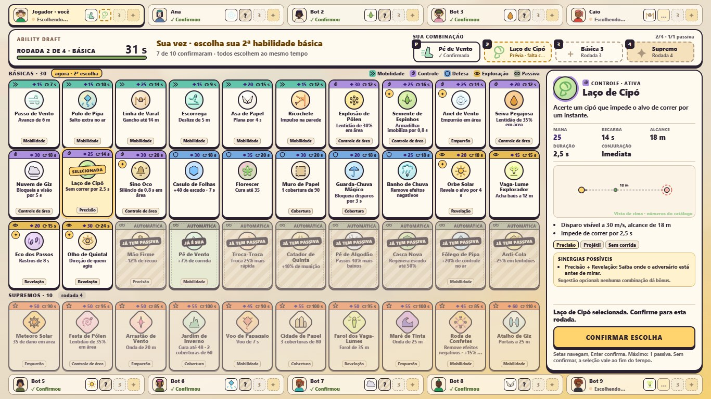
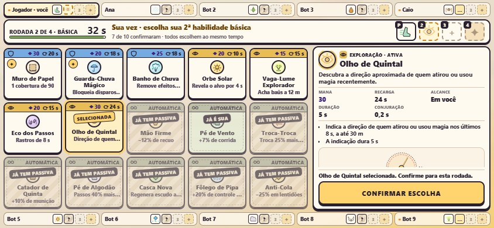

# Ability Draft — experiência implementada

O draft prepara a combinação de habilidades da partida. O host inicia a partida com a sala pronta; os participantes
(pessoas e bots) entram juntos no draft, antes da preparação e do combate. O servidor define participantes, rodadas,
tempo, validação e habilidades finais; a tela só mostra, pré-seleciona e envia `DRAFT_PICK`.

Desde 20/10/2026 (Master Plan 3.0, fase B / M3) a tela é um **tabuleiro único**: os dez participantes, as 30 básicas e
os 10 Supremos ficam visíveis ao mesmo tempo, sem abas nem paginação.

## Estrutura e tempo (regras, inalteradas)

São quatro rodadas simultâneas, nesta ordem:

| Rodada | Tipo | Tecla durante a partida |
| --- | --- | --- |
| 1 | Primeira habilidade básica | 1 |
| 2 | Segunda habilidade básica | 2 |
| 3 | Terceira habilidade básica | 3 |
| 4 | Supremo | 4 |

Cada rodada oferece **45 segundos** para inspecionar e confirmar e termina antes quando todos confirmam. A revelação
dura **1,6 segundo**. Esses valores são os padrões de `DRAFT_RULES`; testes e opções internas de sala podem fornecer
tempos específicos. A janela de 20 s de repescagem continua no protocolo por compatibilidade, mas as regras atuais não
geram conflitos (veja Catálogo e propriedade).

O cronômetro usa `endsAt` e o relógio do servidor. Nos últimos cinco segundos de uma escolha ainda aberta, ele recebe
destaque de urgência e os sinais sonoros existentes.

## Hierarquia da tela (desktop)

- **Participantes em cima e embaixo:** cinco cartões em cada faixa (você é sempre o primeiro). Cada um tem avatar
  desenhado com a aparência do participante (bots usam a aparência sorteada pelo servidor), nome, estado
  (“Escolhendo…”, “✓ Confirmou”, “✓ Revelado”, “✓ Pronto”) e os **quatro slots** com estado:
  - **vazio** — rodada futura (número da rodada ou ✦ do Supremo);
  - **atual** — a rodada em aberto, ainda escolhendo (“…”, pulsando);
  - **prévia** — só no seu cartão: a carta selecionada e ainda não confirmada (borda tracejada);
  - **confirmado** — habilidade pública já atribuída, ou a sua escolha já enviada nesta rodada;
  - **oculto** — outro participante confirmou em segredo (“?” hachurado). A escolha alheia nunca aparece antes da
    revelação (`draftSlots` em `DraftScreen.ts`, coberto por teste).
- **Barra central:** “ABILITY DRAFT”, “RODADA n DE 4 · BÁSICA/SUPREMO”, segundos e barra de tempo; a **indicação de
  turno** (“Sua vez · escolha sua 2ª habilidade básica”, “Escolha garantida · aguardando Bot 3”, “Revelando as
  escolhas da rodada 2”) com “7 de 10 confirmaram · todos escolhem ao mesmo tempo”; e **Sua combinação**: os quatro
  slots com tecla de combate (P para a passiva), nome e estado (“Prévia · falta confirmar”, “✓ Confirmada ·
  aguardando”), com **Trocar** enquanto a rodada está aberta.
- **Grade das básicas (30):** 10 colunas × 3 linhas, agrupadas por categoria (Mobilidade, Controle, Defesa,
  Exploração, Passivas), com legenda de categorias. Marca “agora · 2ª escolha” na rodada em que vale.
- **Grade dos Supremos (10):** uma linha separada, “agora · rodada 4” na última rodada.
- **Painel de detalhe** à direita, com **CONFIRMAR ESCOLHA** / **ALTERAR SELEÇÃO** sempre visíveis no rodapé.

A grade que não vale na rodada fica esmaecida, mas continua lendo e mostrando detalhes (os Supremos podem ser
estudados desde a rodada 1). Em 1366×768 e 1920×1080 as 40 cartas e os 10 participantes cabem sem rolagem
(medido, ver Verificação). Em 1920×1080 as cartas também mostram o rótulo da categoria e a descrição do catálogo.

## Cartas

Cada carta traz, sem nenhum asset de terceiros:

- **Faixa de categoria:** cor da categoria + glifo próprio (setas, espiral, escudo, olho, laço, estrela) — a cor
  nunca é a única pista. À direita, **◆ custo de Mana** e **⟳ recarga** (passivas: “AUTOMÁTICA”).
- **Ícone autoral** (SVG de `abilityIcons.ts`) num disco com contorno de tinta; **silhueta por tipo**: ativa com
  borda simples, passiva com contorno tracejado interno, Supremo com borda dupla dourada e ícone em losango.
- **Nome**, **linha de efeito** gerada do catálogo (“Lentidão de 30% em área”, “Armadilha: imobiliza por 0,8 s”,
  “+40 de escudo · 7 s”) e, quando há espaço, a **descrição curta** (`blurb`).
- **Papéis táticos** (chips): Empurrão, Controle de área, Revelação, Precisão, Mobilidade, Curta distância,
  Cobertura, Longa distância.
- **Carimbos de estado:** SELECIONADA, CONFIRMADA, JÁ É SUA (na sua combinação), JÁ TEM PASSIVA (limite de uma
  passiva), e na revelação o nome de quem ficou com ela (ou “3 JOGADORES”). ✦ marca uma sinergia com a sua
  combinação.

## Painel de detalhe — gerado só do catálogo

Tudo vem de `@graao/game-data` (`ABILITIES`): nada é escrito à mão na tela além dos rótulos.

- Categoria · tipo, nome, descrição (`blurb`).
- **MANA, RECARGA, ALCANCE** (“Em você” para habilidades próprias), **DURAÇÃO** (o efeito mais longo; áreas contam
  o intervalo entre o primeiro e o último pulso; “Instantânea” abaixo de 0,5 s) e **CONJURAÇÃO** (`castTime`).
- **Prévia esquemática** (`abilityDiagram.ts`): um SVG desenhado com os números do catálogo — vista de cima para
  disparos, áreas, armadilhas, nuvens, coberturas, ondas, portais, escudo frontal e revelações; vista de lado para
  salto, gancho, planar, voo e ricochete; barras “sem / com” para passivas. Distâncias em escala dentro do desenho,
  rótulos só com números do catálogo e um laço curto de CSS (desligado com `prefers-reduced-motion`). Não é uma
  segunda simulação: nada é calculado em tempo real.
- **Efeitos** (`abilityFacts.ts`): uma frase por efeito real, com o caminho do efeito de onde vem
  (`effects[0].onHit[0]`). Exemplos: “Disparo visível a 40 m/s, alcance de 20 m”, “Área de 7 m de raio · aviso de
  0,5 s”, “32 pulsos em 7,75 s”, “Novas aplicações desses efeitos duram 65% menos por 2 s”.
- **Papéis** e **tags** do catálogo (rótulos em português; tags repetidas por um papel não aparecem duas vezes).
- **Sinergias** (ver abaixo).

O teste `apps/client/src/ui/abilityFacts.test.ts` falha se: um fato apontar para um efeito que não existe ou de outro
tipo; o tipo/modo do efeito não for executado pelo sistema autoritativo (`AbilitySystem.run`, `passives.ts`,
`character.ts`); qualquer número exibido (fato, resumo da carta, estatística, rótulo do diagrama ou descrição do
catálogo) não vier dos campos do próprio efeito; algum efeito ficar sem texto; uma tag aparecer sem efeito que a
sustente. Achados que ele travou:

- O raio da revelação do Orbe Solar não limita nada (a revelação segue o primeiro alvo atingido): não aparece mais.
- O Fôlego de Pipa prometia “reduzir consequências de quedas”, mas o modificador `fallDamage` não tem consumidor no
  jogo. A descrição do catálogo passou a falar só do controle no ar (o dado `bonus` ficou, sem efeito, como antes).

## Sinergias sugeridas (sem bônus)

`abilityRoles.ts` lê os papéis táticos dos efeitos (empurrão = `knockback`/`wave`; controle de área = área com
lentidão/imobilização/silêncio/sem corrida, nuvem ou armadilha; revelação = revelar adversários; precisão = disparo
ou Mão Firme; mobilidade = avanço, movimento, portal, velocidade ou passivas de corrida/ar; curta distância = efeito
sobre outros até 8 m; cobertura = muro, escudo frontal ou nuvem; longa distância = alcance ≥ 20 m ou revelação ≥ 30 m).

Pares sugeridos: **Empurrão + Controle de área**, **Revelação + Precisão**, **Mobilidade + Curta distância**,
**Cobertura + Longa distância**. Com algo na sua combinação (confirmado ou prévia), as cartas da rodada que fecham um
par ganham ✦ e o painel diz “✦ COMBINA COM SUA COMBINAÇÃO · Orbe Solar · Precisão + Revelação: …”; sem combinação,
o painel lista as sinergias possíveis da carta. Sempre com “Sugestão opcional: nenhuma combinação dá bônus.” O teste
`abilityRoles.test.ts` confere que cada papel tem efeito por trás e que nenhum arquivo de `game-core`, `game-data`,
`shared` ou do servidor conhece sinergias — elas não chegam à simulação.

## Selecionar e confirmar

1. Passar o mouse ou focar uma carta mostra o detalhe; ao sair da grade, o painel volta para a sua seleção.
2. Clicar (ou tocar) numa carta válida da rodada seleciona uma **prévia local**: aparece no seu slot e na carta
   (“SELECIONADA”). Ainda não envia `DRAFT_PICK`. Cartas indisponíveis (outra rodada, já na sua combinação, segunda
   passiva) só abrem o detalhe.
3. **CONFIRMAR ESCOLHA** (ou **Enter** na carta selecionada / fora de botões) envia ao servidor; enquanto aguarda, a
   ação fica indisponível.
4. Confirmada, a tela mostra “Confirmada · aguardando” e permite **ALTERAR SELEÇÃO** / **Trocar** enquanto a rodada
   continua aberta. A escolha anterior vale até a nova confirmação.

Teclado: as cartas são botões em ordem de tabulação; **setas** andam pela grade (para baixo da última linha das
básicas chega aos Supremos e volta). As teclas numéricas da versão paginada saíram (40 cartas não cabem em 1–9).

## Celular em paisagem (≤ 450 px de altura)

O jogo no celular é só paisagem. Com altura ≤ 450 px:

- as duas faixas de participantes ficam compactas (nome, ● escolhendo, quatro slots de 17 px);
- a barra central e **Sua combinação** (ícones com tecla) ficam **fixas** no topo;
- a grade das 40 cartas **rola** (5 colunas em 844 px, cartas de ≥ 84×88 px, alvos de toque confortáveis); na rodada
  do Supremo a grade dos Supremos vem primeiro, e cada rodada abre no topo da grade;
- **toque** numa carta abre o detalhe no painel lateral (efeitos antes do diagrama) e seleciona a prévia;
- **CONFIRMAR ESCOLHA** (40 px) fica fixo no rodapé do painel, fora da rolagem.

Larguras até 1180 px com altura maior que 450 px (tablets, janelas estreitas) usam a mesma grade rolável com a barra
em duas linhas. Retrato estreito tem um empilhamento simples, mas o celular pede para girar.

## Quando o tempo acaba

- **Há uma prévia local válida:** o cliente a confirma uma única vez quando faltam até 200 ms no relógio do servidor
  e explica a confirmação automática. O servidor valida o envio.
- **Já há uma escolha confirmada:** ela continua valendo; nenhum reenvio.
- **Não há seleção válida recebida:** o servidor escolhe uma opção válida; a revelação marca a escolha por tempo
  (⏱ no slot e “Tempo esgotado: … foi escolhida automaticamente”).

O cliente nunca substitui as habilidades finais por conta própria; se a aba ficar suspensa ou a rede atrasar, a
resolução de tempo do servidor conduz o draft.

## Catálogo e propriedade

O catálogo tem **30 básicas (22 ativas + 8 passivas) e 10 Supremos**. A exclusividade é **individual** em todo tamanho
de sala: nenhuma habilidade se repete na mesma combinação e cada combinação tem no máximo **uma passiva**. Jogadores
diferentes podem escolher a mesma habilidade (na revelação, a carta mostra quantos a pegaram). Os campos de
prioridade/repescagem do protocolo seguem aceitos por compatibilidade com servidores antigos (`unique`).

## Layout e integração

`apps/client/src/ui/DraftScreen.ts` monta o tabuleiro (DOM/CSS/SVG); `abilityFacts.ts`, `abilityRoles.ts` e
`abilityDiagram.ts` são módulos puros (testáveis no Node) que geram textos, papéis e diagramas a partir do catálogo;
`apps/client/src/styles/draft.css` cuida do layout (grade de 10 colunas, container queries nas cartas, modo celular).
A API de integração ficou igual: `show(on)`, `visible`, `setState(state, me, names, looks)`, `update(serverNow)` e
`setKeyBindings`. Protocolo, servidor e regras não mudaram: o envio continua `DRAFT_PICK`, a recepção `DRAFT_STATE`.

## Verificação

- `apps/client/src/ui/abilityFacts.test.ts` — texto exibido × `effects` reais e código autoritativo (acima).
- `apps/client/src/ui/abilityRoles.test.ts` — papéis com efeito por trás, os quatro pares com cartas dos dois lados,
  sugestões só com a metade que falta, nenhuma sinergia na simulação.
- `apps/client/src/ui/DraftScreen.test.ts` — as 40 magias em duas grades (30 + 10) sem páginas; disponibilidade da
  tela igual à regra autoritativa em **todas as 40 cartas** ao longo de um draft de **10 assentos** (8 escolhendo como
  os bots do servidor, 1 só pelo tempo, ≤ 1 passiva, 4 escolhas válidas); estados dos slots (prévia, confirmado,
  oculto, espectador); confirmação automática perto do prazo.
- `packages/game-core/src/draft.test.ts`, `tests/abilities-v2.multiplayer.test.ts` (draft de dez assentos com 1 e 2
  humanos e bots) e `tests/multiplayer.test.ts` — regras e integração com o servidor.
- `tools/ux/draft-captures.ts` → [draft-visual-checks.json](draft-visual-checks.json) e capturas
  `screenshots/draft-v3-*.jpg`: em 1366×768 e 1920×1080, 10/10 participantes e 40/40 cartas na tela sem rolagem,
  combinação e confirmar visíveis, sem abas/páginas, sem rolagem horizontal; em 844×390 e 740×360, 10/10
  participantes, grade rolável com as 40, confirmar de 40 px fixo; clique + Enter e toque + confirmar enviam
  exatamente um `DRAFT_PICK`.
- `tools/ux/draft-live.ts` → [draft-live-check.json](draft-live-check.json): draft real pela tela contra o servidor
  autoritativo com 9 bots; rodadas resolvidas ~2 s após confirmar, a rodada deixada como prévia confirmada no fim dos
  45 s, 7 passivas bloqueadas depois da primeira, 10 combinações válidas, a do jogador igual às escolhas da tela, e a
  sala seguiu para a preparação.

Pendente para o contrato DONE: celular físico (o modo celular foi medido com emulação de toque) e pessoas jogando
o draft em máquinas diferentes (depende do Gate B).

Comando da suíte completa: `pnpm exec vitest run`.
