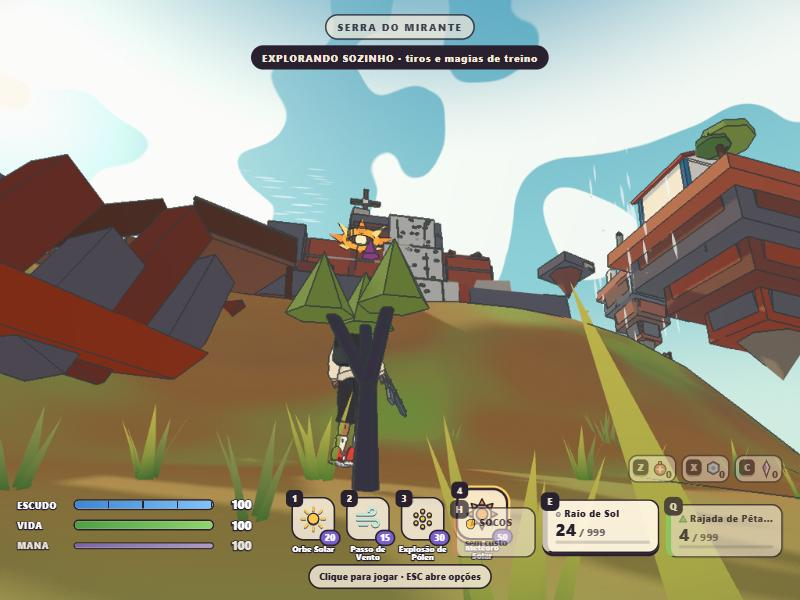
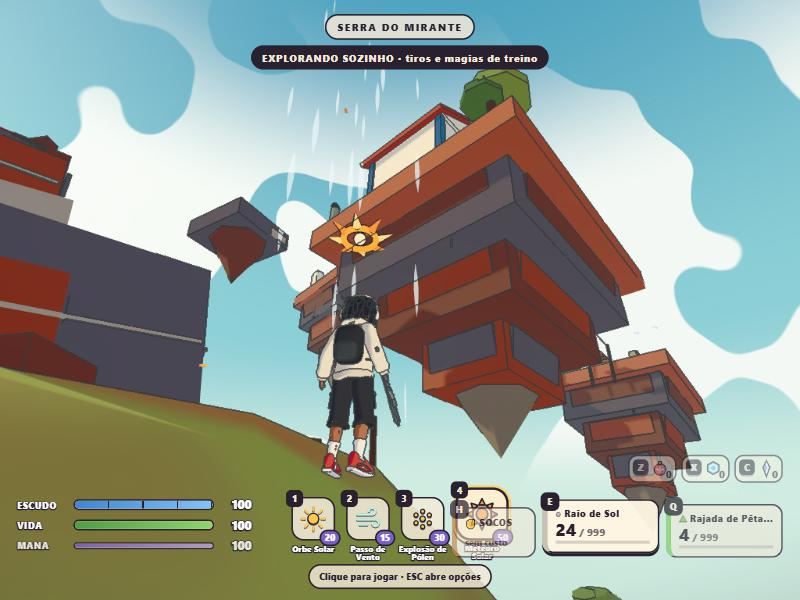
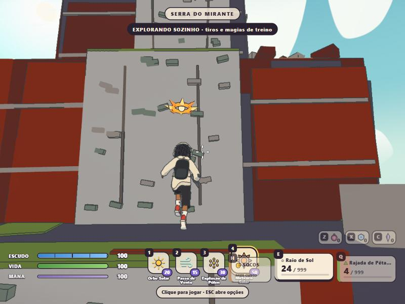
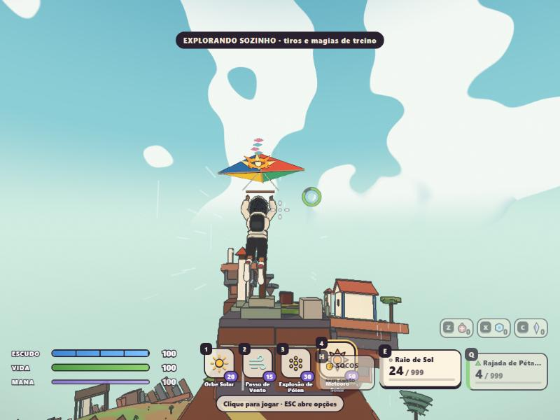
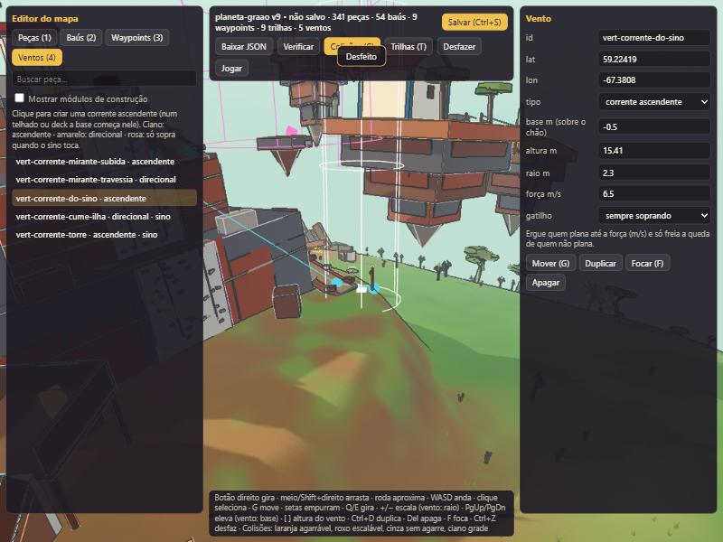

# Relatório de testes — Vertical World & Traversal (19/10/2026)

Estados conforme [RELEASE_GATES](RELEASE_GATES.md). Nada aqui foi verificado em redes externas, celular ou com dez
participantes humanos.

## Resumo por gate do roadmap

| Gate | Estado | Evidência |
|---|---|---|
| V0 Auditoria | DONE | [auditoria](../gameplay/VERTICAL_TRAVERSAL_AUDIT.md) com baseline |
| V1 Movimento (beirada, mantle, escalada curta, planagem) | TESTING | 29 testes do motor; navegador solo e online |
| V2 Autoridade e rede | TESTING | servidor real + 2 clientes (Node); Chromium × servidor local (correção ≤ 6 mm); sem latência simulada nem rede externa |
| V3 Correntes de vento | TESTING | 10 testes; ventos do mapa real; sincronia do sino em rede |
| V4 Serra do Mirante | TESTING | 3 rotas chegam ao cume no motor real (12,2 s / 5,0 s / 4,3 s); arte em blocos, polimento pendente |
| V5 Ilha do Sino | TESTING | acesso universal, caminhada, ponte, pedras, saída por planagem, baús; combate na ilha não exercitado em partida |
| V6 Editor | TESTING | aba Ventos, cores de colisor por tag, família VERTICAL; salvar/recarregar pelo script de autoria e pelo validador |
| V7 Arquipélago | TESTING | 3 ilhas, 2 sinos com evento autoritativo |
| V8 Bots e creeps | PARTIAL | bot sobe a trilha até o cume; bots sem travessia; ilhas fora do grafo ([limites](../world/VERTICAL_BOT_NAVIGATION.md)) |
| V9 Polimento | PARTIAL | animações procedurais (pendurar, planar) + clipe UAL (escalar/subir); pipa; vento com faixas, folhas e som; câmera; sem input touch |
| V10 Validação final | NOT_STARTED | precisa de partidas reais 1v1, 2 humanos + bots, 10 participantes, mobile e Graao Host novo |

## Testes automatizados

| Arquivo | Testes | O que prova |
|---|---|---|
| `packages/game-core/src/traversal.test.ts` | 29 | matemática radial (queda ao longo do up local em 6 pontos da esfera, suporte numa ilha pelo collider), tabela de estados (chão → pulo → queda → chão), beirada/mantle/escalada/planagem, anti-abuso, empurrão e magia, contrato de predição |
| `packages/game-core/src/wind.test.ts` | 10 | coluna e esvaecimento, sem pipa não sobe, com pipa sobe e pousa na ilha, direcional não passa da velocidade, stamina limita o pairar, replay idêntico, sino (alcance, tempo, recusa, espelho do cliente), teto radial, Tormenta por direção em altitude e no lado oposto |
| `tests/world.vertical.test.ts` | 8 | mapa real: rotas A/B/C ao cume, ilha pela corrente, ponte + pedras até a Ilha da Torre, os dois sinos (com e sem), bot pela trilha, ilhas fora do grafo dos bots |
| `tests/traversal.multiplayer.test.ts` | 5 | servidor Colyseus real + 2 clientes SDK: B vê CLIMB/MANTLE/terraço e GLIDE subindo; stamina no snapshot; sino recusado de longe, aceito de perto para os dois clientes, vento ligado no motor da sala, segundo toque recusado |
| Suíte completa | **607/607** em 63 arquivos (284 s, com o mapa final) | inclui os testes de rotas, navegação e interativos do mapa com o conteúdo novo |

Typecheck (raiz, cliente, host) limpo.

## Navegador (painel do app, Chromium)

- Solo: escalada → mantle → terraço; planagem na corrente oeste (7 → 20,7 m); paredão sem decoração atravessando
  a face (corrigido nesta rodada); sino do cume (prompt, toque, vento ligado na predição, aviso).
- Online contra o servidor local (`graao-server-vertical`, sala dev com bot): escalada e rota B até o cume com
  correção máxima de reconciliação 1,4 mm e 5,9 mm.
- Editor `?editor`: aba Ventos com as colunas, inspetor, redimensionar/elevar/altura, desfazer.
- Capturas: `docs/world/screenshots/vertical-*.jpg`.

## Cenários multiplayer pedidos (25)

| # | Cenário | Situação |
|---|---|---|
| 1 | A escala e B observa | feito (Node, `traversal.multiplayer`) |
| 2 | A agarra beirada | coberto pelo motor (mesmo código no servidor); em rede só a escalada foi observada |
| 3 | A sobe no telhado | motor (script da vila: 29/72 paredes térreas levam ao telhado); não em rede |
| 4 | A plana de uma estrutura | planagem observada em rede a partir da corrente |
| 5 | A entra em corrente | feito (Node) |
| 6 | A chega a uma ilha | motor real; não em rede |
| 7–9, 11 | combate entre altitudes, perseguição por magia, empurrão e queda | **não feito** em partida; a regra de empurrão solta a travessia e tem espera (teste de motor) |
| 10 | A aterrissa | motor e rede (planagem fecha no pouso) |
| 12 | Tormenta fecha sobre a região | regra testada por direção/altitude; não numa partida real |
| — | Latência simulada | **não feito** |
| — | Redes externas | **não feito** (BLOCKED: máquinas do M2) |

## Bots (26)

Feito: bot usando rampas (link de subida da trilha) até o objetivo (cume), contornando o maciço, sem modos de
travessia. Não feito: fugir da Tormenta por rota vertical, abandonar rota inviável, voltar ao combate depois da
subida (os mecanismos gerais do `BotBrain` existem, mas não foram exercitados na Serra).

## Problemas encontrados e corrigidos nesta rodada

1. Construção larga no plano tangente: o pé da rampa 1 ficava 0,6 m acima do chão (degrau intransponível sem pulo).
2. Waypoints com altura radial sem curvatura: um nó da trilha caiu dentro da rocha e o A* preferia um atalho
   impossível (bot subia e descia a rampa sem parar).
3. Controle aéreo anulava o vento direcional (o vento agora desloca o referencial do ar).
4. Lâminas decorativas inclinadas atravessavam a frente do paredão (visual).
5. Corrente de travessia estendida sobre o cume levava o planador além dele.
6. Sinal invertido no giro de direção do script de autoria (ventos direcionais sopravam ao contrário).
7. Planagem continuava aberta no passo do pouso.
8. Teto radial novo: testes antigos que caíam de 60 m passaram a 36 m.

## Pendências

- Input touch (não existe controle touch no jogo; o modo mobile pedido é trabalho próprio).
- Partidas reais com combate vertical, empurrões nas bordas, explosões e Muro de Papel nas ilhas.
- Arte final da Serra e das ilhas (silhueta, cor), clipes de animação dedicados (pendurar, planar), roupa ao vento.
- Bots com travessia (`BotTraversalLink`), creeps aéreos.
- Graao Host: instalador novo para o protocolo 11 (publicação exige aprovação).
